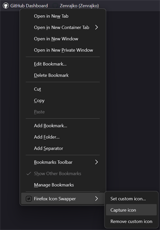
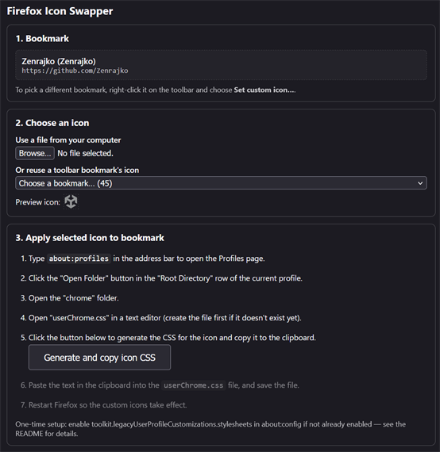

# Firefox Icon Swapper

A Firefox WebExtension that hides the real favicon of a bookmark on the bookmarks toolbar and paints your own icon on top.

It does this by **generating CSS for `userChrome.css`**, which overlays the icon at render time. Nothing about the bookmark or Firefox's favicon storage is modified.

## How it works

1. Right-click any bookmark → **Set custom icon…** (works from the bookmarks toolbar). The options page opens showing that bookmark as the target.

   

2. Choose an icon: pick a file from disk, or **reuse another bookmark's icon** directly (custom icons copy instantly; a site's own icon is fetched live where the site allows it). You can also right-click a bookmark → **Capture icon** to save that site's favicon to disk for later use — no page opens on success.

   

3. Click **Generate and copy icon CSS** — it saves the icon and copies the generated CSS (replacing each bookmark's toolbar icon with your chosen one, painted as a `background-image` on the bookmark button) straight to the clipboard.
4. You paste that CSS into `chrome/userChrome.css` in your profile folder and restart Firefox.

## Manual one-time setup (required)

WebExtensions **cannot** enable preferences or write into your profile folder, so two manual steps are needed before the extension's output takes effect.

### Step 1 — Enable userChrome.css in about:config

1. Open `about:config` in Firefox and click through the warning.
2. Search for `toolkit.legacyUserProfileCustomizations.stylesheets`.
3. Click the toggle so the value becomes `true`.
4. Restart Firefox.

### Step 2 — Create the userChrome.css file

1. Open your profile folder: Menu → Help → **More Troubleshooting Information** → under "Application Basics" → **Profile Folder** → **Open Folder**.
2. Inside the profile folder, create a `chrome` folder (all lowercase) if it doesn't exist.
3. Inside `chrome`, create a file named `userChrome.css` (exact case; on Windows make sure the file doesn't silently get a `.txt` extension).

## Install the extension

Either:

- **Temporary load:** open `about:debugging#/runtime/this-firefox` → **Load Temporary Add-on…** → select `extension/manifest.json`. The extension stays until Firefox restarts (you can re-load after restart). Good for development.
- **Permanent:** package the `extension/` folder as an `.xpi` (zip it so `manifest.json` is at the zip root) and drag it into `about:addons`. For a permanent unsigned install you'll need a custom build or unbranded Firefox; see PLAN.md.

## Usage

1. Install the extension and do the two manual steps above once.
2. Right-click a bookmark on the toolbar → **Set custom icon…**. The options page opens showing that bookmark; to change the target, close it and right-click a different bookmark.
3. Choose an **icon** (PNG/SVG recommended; ICO also works): **Use a file from your computer**, or open the **reuse a toolbar bookmark's icon** list and pick a bookmark — the icon loads immediately on selection. The two ways replace each other (choosing one clears the other), and the chosen icon appears in the shared preview. The reuse list only shows bookmarks sitting directly on the toolbar, so if the icon you want isn't on it yet, drag that bookmark there first. Reusing copies an existing custom icon immediately; if the source has none, it tries to fetch that site's icon live (and if the site blocks it, suggests the **Capture icon** menu instead).
4. Click **Generate and copy icon CSS** — this saves the mapping and copies the generated CSS to the clipboard.
5. Paste the clipboard contents into `chrome/userChrome.css`, save, and restart Firefox.
6. The toolbar icon is now yours. Add as many bookmarks as you like — each Apply regenerates and re-copies the full CSS, so you can re-paste it into `userChrome.css`.

To change icons later, reopen the options page (right-click the bookmark again), pick new files, Apply, and re-paste the refreshed CSS. **Remove custom icon** deletes a mapping.

## Limitations

- **Local only:** the CSS lives in `userChrome.css` on this machine/profile. It doesn't sync or follow you to other devices.
- **Manual paste:** the extension can't write the file for you (WebExtensions have no profile-directory access), so you re-paste after each change.
- **Matched by bookmark title:** the CSS selects on the `label` attribute, so if two toolbar bookmarks share a title, both get the same icon. Renaming the bookmark after applying breaks the match — re-apply. A bookmark with **no title** (shown as a bare icon) has no name to match on, so it is selected with the empty-label selector `[label=""]` instead; that works only while it is the *only* caption-less bookmark on the toolbar, which is why the extension refuses to generate CSS when several toolbar bookmarks have no title.
- **Fragile across Firefox redesigns:** browser UI internals change over time (e.g., the Proton overhaul). If selectors stop working after a major update, tweak them in `generateCss()` in `options/options.js`.
- **Toolbar only:** this affects the bookmarks toolbar (and popups sharing those elements), not the Library sidebar or the stored favicon itself. Sites' real favicons are untouched. Likewise, the "reuse another bookmark's icon" list only contains bookmarks sitting directly on the bookmarks toolbar, not those inside its subfolders — move the source bookmark up to the toolbar first if needed.
- **Capture needs the `tabs` permission:** capture/reuse read the site's favicon via `tab.favIconUrl` (handled in the background script, reusing an already-open tab for that page and otherwise opening a brief background tab). There's no extension API that reads Firefox's favicon database, so the manifest declares the *least sensitive* natural permission that works (`tabs`), consciously avoiding heavier `host_permissions`/content scripts (and the `tabHide` permission, which would only hide the background tab visually). See PLAN.md for the trade-off. "Reuse an icon" only reads a site's icon live when the site allows cross-origin reads; otherwise it falls back to the **Capture icon** menu, which downloads exactly what the site serves. If a site blocks bots or never sets a `<link rel="icon">`, captures time out (25 s) — assign a file manually instead.

## Troubleshooting

- **Nothing changed:** verify the `about:config` pref is `true`, that the CSS is actually inside `chrome/userChrome.css` (not `.txt`), and that you restarted Firefox after pasting.
- **Icon won't override:** both halves of the rule are required — the real favicon is hidden via `> .toolbarbutton-icon { display: none }` and your icon is painted as a `background-image` on `.bookmark-item` (see `generateCss()`). Pasting only one of them leaves the site favicon showing. If you see *two* icons side by side, the old rule is still in your `userChrome.css` next to the new one — delete the previous block when re-pasting.
- **Wrong bookmark matched:** duplicate titles — see "Matched by bookmark title" above.
- **Capture timed out:** the site is slow, bot-blocked, or serves no `<link rel="icon">` (or it's a login wall). Open the site manually and pick its icon via the file picker instead.
- **"Reuse another bookmark's icon" failed:** the source site doesn't allow its icon to be read cross-origin. Right-click that bookmark → **Capture icon** to save it to disk, then choose the file.
- **Stopped working after a Firefox update:** selectors (`#PlacesToolbar .bookmark-item`) may have changed; inspect with the Browser Toolbox (devtools.enabled + Ctrl+Shift+Alt+I) and adjust `generateCss()`.

## Project layout

```
firefox-icon-swapper/
├── README.md            # this file
├── AGENTS.md            # guidance for AI/agents working here
├── PLAN.md              # design rationale and implementation plan
├── extension_menu.png   # screenshot: the bookmark context menu
├── extension_screen.png # screenshot: the options page
└── extension/
    ├── manifest.json    # MV3 manifest
    ├── background.js    # bookmarks context menu
    ├── icons/           # extension icon
    └── options/         # options page (picker + CSS generator)
```